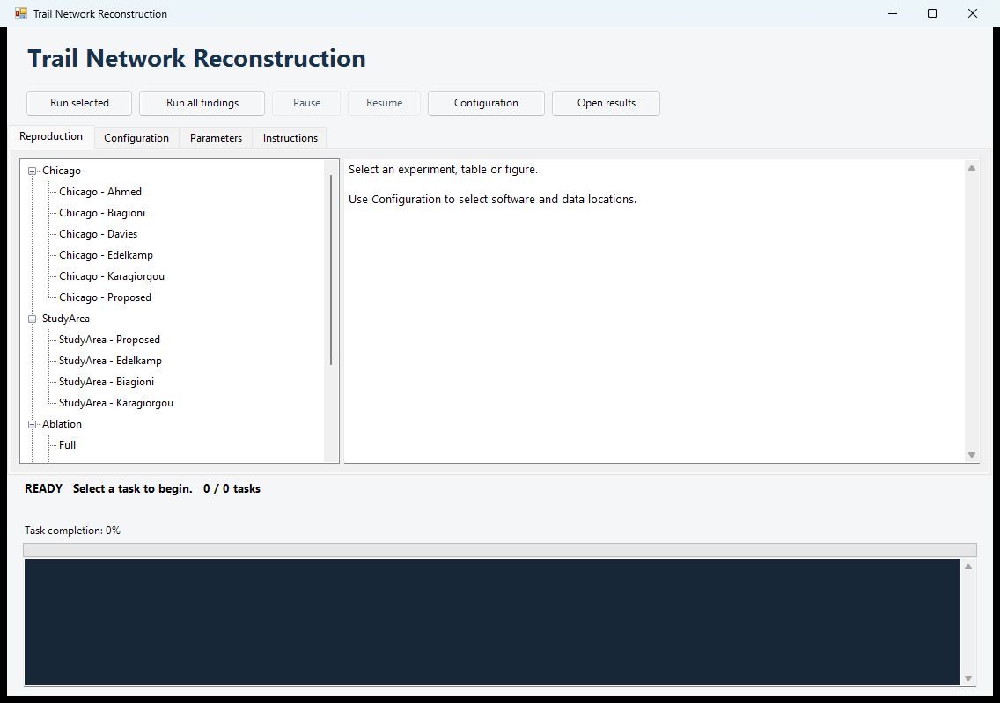
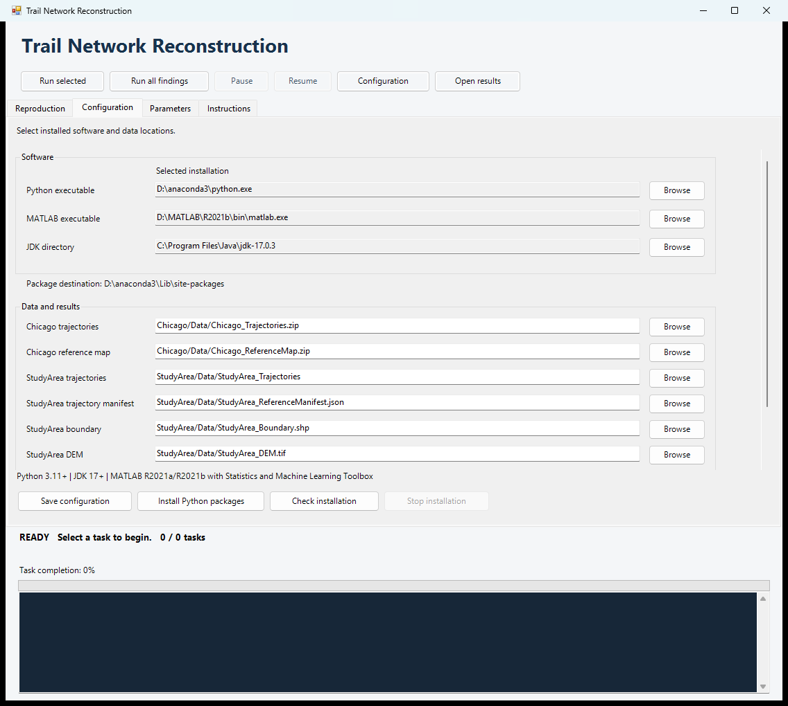
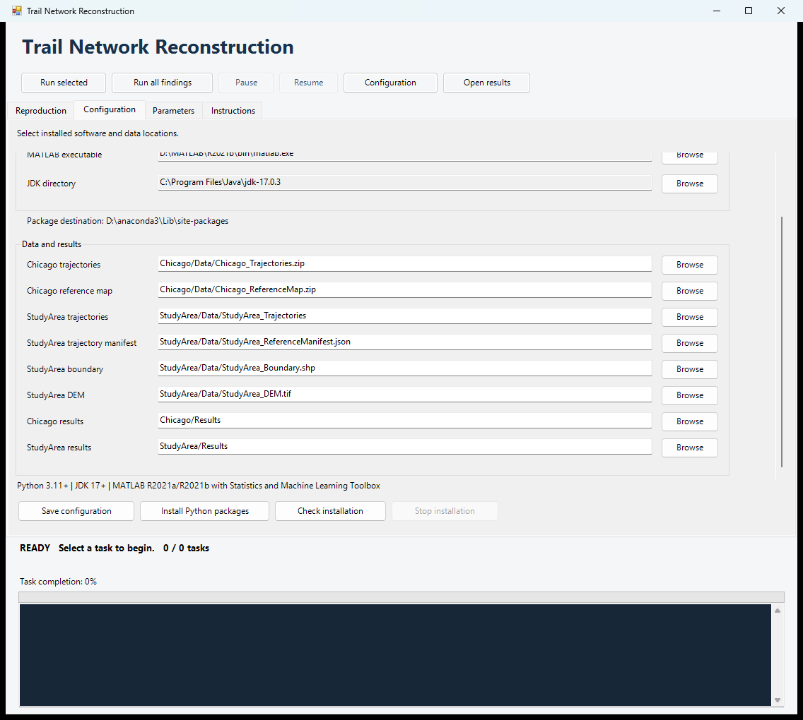
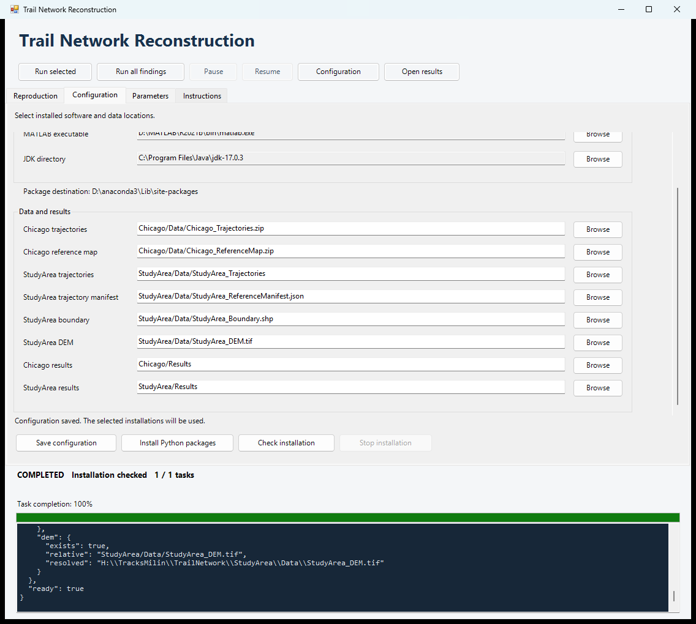
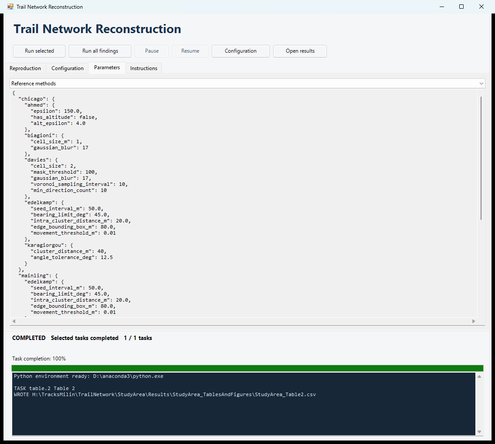
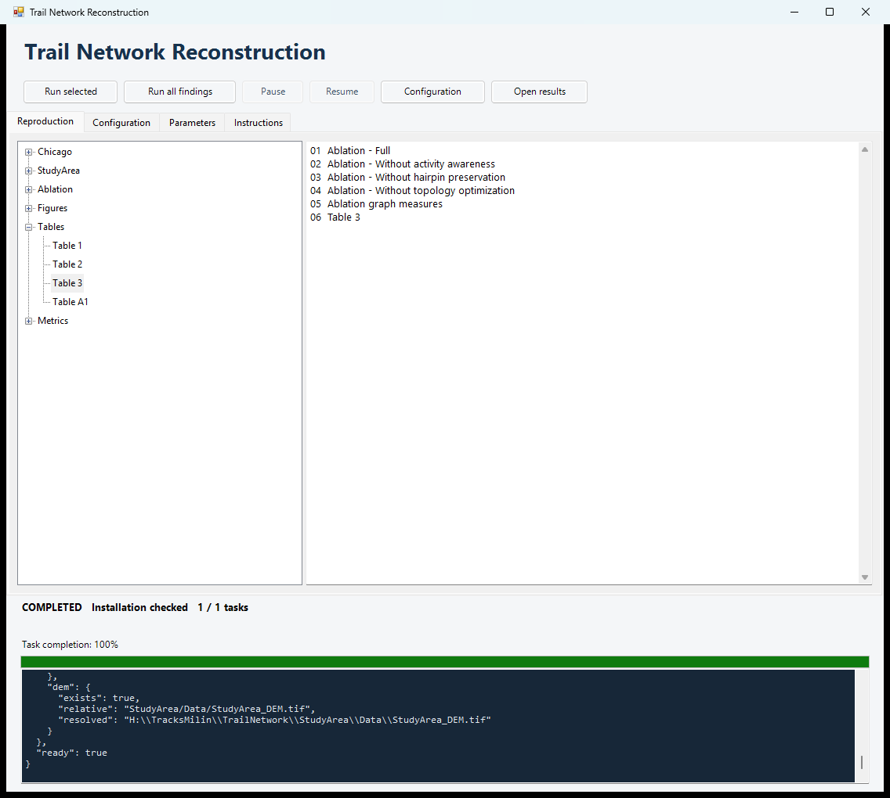
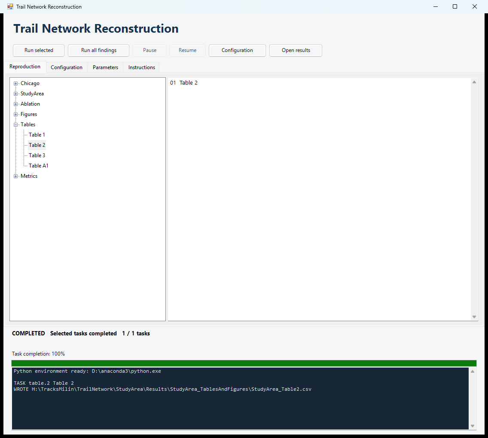
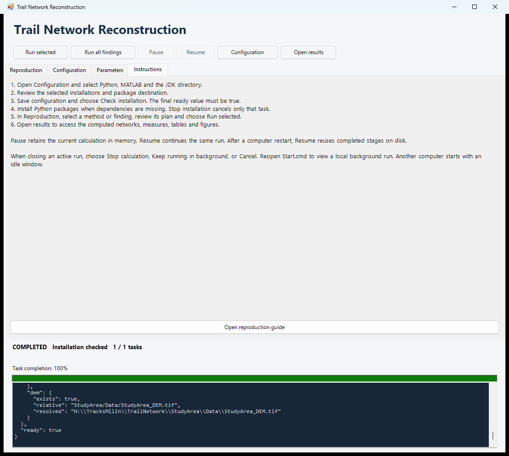

# Reproduction instructions: Tables 1–3 and A1; Figures 8–12

This file links each manuscript finding to its published inputs, calculation steps, window task and generated outputs. The reproduction scope is **Table 1, Table 2, Table 3, Appendix Table A1, and Figures 8–12**, using the numbering in the revised manuscript. The associated accuracy, structural and ablation measures are included.

## 1. Configure and run with the illustrated window guide

Open `Start.cmd` in the extracted package. The screenshots below show the current publication interface. Use **Browse** to select the software installed on your computer. The displayed installation paths illustrate one local configuration; the package supplies relative data and output locations. Resize the window or scroll the Configuration panel to display all fields.

### 1.1 Open the Reproduction page

The left tree groups **Chicago**, **StudyArea**, **Ablation**, **Figures**, **Tables** and **Metrics**. The upper toolbar contains **Run selected**, **Run all findings**, **Pause**, **Resume**, **Configuration** and **Open results**. The right panel displays the dependency plan for the selected item. The lower panel displays task status, progress and the run log.



**Screen 1. Main window.** Start with the required dataset, experiment or manuscript item in the task tree.

### 1.2 Select Python MATLAB and the JDK

1. Open **Configuration** using its tab or the toolbar button.
2. Choose **Browse** beside **Python executable** and select `python.exe` from the environment to use.
3. Select the **MATLAB executable** and the **JDK directory**. The JDK selection supplies Java and Javac together.
4. Read the **Selected installation** fields and **Package destination**. Choose **Save configuration**.

Use 64-bit Python 3.11 or newer, JDK 17 or newer, and MATLAB R2021a/R2021b with Statistics and Machine Learning Toolbox. Python packages and temporary installation downloads use the selected Python environment.



**Screen 2. Software selections.** Browse to the installed executables on the current computer. Configuration keeps these selections together with the data and result locations.

### 1.3 Confirm data and result locations

Scroll to **Data and results** in the same Configuration page. Retain the supplied entries below for the published experiments. Keep the boundary's `.shp`, `.shx`, `.dbf`, `.prj` and `.cpg` files together. Choose **Save configuration** after selecting any location.

| Field | Supplied relative location |
| --- | --- |
| Chicago trajectories | `Chicago/Data/Chicago_Trajectories.zip` |
| Chicago reference map | `Chicago/Data/Chicago_ReferenceMap.zip` |
| StudyArea trajectories | `StudyArea/Data/StudyArea_Trajectories` |
| StudyArea trajectory manifest | `StudyArea/Data/StudyArea_ReferenceManifest.json` |
| StudyArea boundary | `StudyArea/Data/StudyArea_Boundary.shp` |
| StudyArea DEM | `StudyArea/Data/StudyArea_DEM.tif` |
| Chicago results | `Chicago/Results` |
| StudyArea results | `StudyArea/Results` |



**Screen 3. Data and results.** The two result folders are inside the extracted package. Local Windows links support software or data selected on another drive; select installed software again when transferring the package to a different computer.

### 1.4 Check the installation

1. Choose **Check installation**. The lower status panel displays **Checking environment** while the check runs.
2. Read the report in the lower log and confirm the final `ready: true` value. The report includes the selected interpreter, package import results, GDAL resources, engine versions and input-file availability.
3. If dependencies are missing, choose **Install Python packages**, then check again. **Stop installation** cancels the installation task.

The report is saved as `Chicago/Results/Chicago_Runtime/environment.json`. The completed check shown below returned `ready: true`.



**Screen 4. Successful installation check.** The status reads **COMPLETED — Installation checked**, and the log ends with `"ready": true`.

### 1.5 Read the supplied parameters

Open **Parameters** and select **StudyArea Proposed**, **Ablation**, **Reference methods**, **Table A1** or **Scenes**. Scroll the displayed JSON to inspect its settings. **Reference methods**, shown below, lists the reconstruction settings for the comparison methods, including the spatial and angular thresholds used by the native implementations. The corresponding named JSON files and the Table A1 workflow provide the complete settings.



**Screen 5. Parameter viewer.** Choose the dataset or experiment profile from the selector above the JSON. The lower status panel retains the most recent task's result while parameters are viewed.

### 1.6 Select a finding and inspect its plan

1. Return to **Reproduction** and expand **Tables** or **Figures**.
2. Select the manuscript item to reproduce. Its calculation dependencies appear on the right.
3. Choose **Run selected** to execute that chain. Choose **Run all findings** for the complete set of tables, figures and reported numerical measures.

The example selects **Table 3**. Its plan includes Full, the three module-removal configurations, the ablation graph measures and the table export. Selecting a finding includes its data preparation and reconstruction dependencies automatically.



**Screen 6. Finding-specific run plan.** The selected item is Table 3; the right panel lists the six tasks required for that item. Sections 3-11 below give the full source-to-output procedure for each manuscript finding.

### 1.7 Follow completion and open the outputs

The lower panel shows the active task, completed task count and log. **Stage progress** reports the current phase's processed items and percentage; each phase has its own counter. Karagiorgou follows the reference implementation's sequential loops and can take several hours or longer on full data.

- **Pause** retains the running process and its memory. **Resume** continues that process.
- After a computer restart, **Resume** restores the saved task selection, reuses completed stages and restarts the unfinished stage.
- Closing an active run offers **Stop calculation**, **Keep running in background** or **Cancel**.

The example below runs **Tables > Table 2** with **Run selected**. Completion is confirmed by **COMPLETED**, `1 / 1 tasks`, and the `WROTE` entry for `StudyArea/Results/StudyArea_TablesAndFigures/StudyArea_Table2.csv`. This table exports the implemented ablation configuration matrix.



**Screen 7. Completed task.** Choose **Open results**, then follow the dataset result folder and the output path specified for the finding. Default products are under `Chicago/Results` and `StudyArea/Results`.

### 1.8 Open the instructions from the window

The **Instructions** tab summarizes configuration, installation checking, task execution and run controls. **Open reproduction guide** opens this file. Continue with the finding-specific sections below to identify the input data, method chain, assessment calculations and final output for each table, figure or numerical measure.



**Screen 8. Instructions.** The guide remains available from the same window used to run the experiments.

## 2. Published source observations

**Chicago.** `Chicago_Trajectories.zip` contains 889 trajectories and 118,360 observations in EPSG:26916. `Chicago_ReferenceMap.zip` contains the benchmark's independent OSM-derived reference graph. The preparation code extracts both archives and converts trajectories into the coordinate and text formats required by each method.

**StudyArea.** `StudyArea_Trajectories/` contains 1,101 anonymized observation CSVs clipped to the study area. S2 uses these observations, the study boundary and the native 10 m DEM crop to generate 1,543 hiking segments with 564,183 retained points. The DEM is stored in EPSG:32646. Sampling transforms coordinates into the DEM CRS; reconstructed networks use EPSG:32647.

Every regional reference method consumes the generated S2 hiking trajectories. The reference input manifest records the trajectory order and hashes used by the MATLAB backend. These trajectories are converted during computation.

## 3. Table 1 — Chicago geometric accuracy and network structure

**Source inputs:** the two Chicago archives in Section 2.

**Window task:** **Tables → Table 1** (`table.1`).

1. Extract trajectory observations and the reference graph; generate projected and geographic method inputs.
2. Run Ahmed, Biagioni, Davies, Edelkamp, Karagiorgou and Proposed. Native implementations construct their graphs from the prepared trajectories. Proposed runs its coordinate adapter, S2 preparation, S3–S5, S6 and two S7 passes.
3. Normalize each native graph to a GeoPackage in EPSG:26916 with `nodes` and `edges` layers.
4. Recompute the common trajectory-coverage raster through the assessment S2–S5 branch. Rasterize the reference and reconstructed graphs on its 2 m grid.
5. Compute precision, trajectory-covered recall and F1 at 15 m; calculate vector edge length and graph cycle rank.
6. Write the table from these calculated values.

**Outputs:** `Chicago/Results/Chicago_TablesAndFigures/Chicago_Table1.csv`, `Chicago/Results/Chicago_TablesAndFigures/Chicago_AccuracyAndStructure.csv`, `Chicago/Results/Chicago_TablesAndFigures/Chicago_AccuracyAndStructure.json`; each method also writes `Chicago/Results/Chicago_<Method>/Chicago_<Method>_Evaluation.json`.

At tolerance τ, precision is the share of reconstructed pixels within τ of the reference (Eq. 12). Recall is the share of trajectory-covered reference pixels within τ of the reconstruction (Eq. 11); reference coverage uses a fixed 15 m trajectory distance. F1 is their harmonic mean (Eq. 13). The same workflow calculates the reported tolerance series at 4, 6, 8, 10, 15, 20, 25, 30, 35 and 40 m in `Chicago/Results/Chicago_TablesAndFigures/Chicago_ToleranceMetrics.csv`.

## 4. Table 2 — Ablation configuration matrix

**Source inputs:** `StudyArea/Ablation/StudyArea_Proposed_Ablation_parameters.json` and the four mechanism profiles in `Chicago/Evaluation/Runtime/workflow/pipeline.py`.

**Window task:** **Tables → Table 2** (`table.2`).

1. Read the Full and three removal-profile identifiers used by the pipeline.
2. Record whether activity awareness, hairpin preservation and topology optimization are enabled in each profile.
3. Export the configuration matrix to `StudyArea/Results/StudyArea_TablesAndFigures/StudyArea_Table2.csv`.

This table defines the experimental configurations. The regional reconstruction and measurements for these configurations are computed by Table 3 and Figures 11–12.

## 5. Table 3 — Ablation network structural measures

**Source inputs:** the published StudyArea observation CSVs, boundary, DEM and `StudyArea/Ablation/StudyArea_Proposed_Ablation_parameters.json`.

**Window task:** **Tables → Table 3** (`table.3`).

1. Run S2 on the published observations to select and clean hiking segments, preserve observation order and sample elevation.
2. Reconstruct four networks with S3–S7. Full enables all mechanisms. The removal profiles set `--disable-activity-aware`, `--disable-uturn-semantics` or `--disable-evidence-topology-optimization` at the corresponding stages.
3. Read each generated final network's `nodes` and `edges` layers and build a multigraph that retains parallel edges and self-loops.
4. Compute length, edge count, connected components, endpoints, junctions, cycle rank and largest-component length share.
5. Export the structural comparison and the six ratios to Full.

**Outputs:** `StudyArea/Results/StudyArea_TablesAndFigures/StudyArea_Table3.csv`, `StudyArea/Results/StudyArea_TablesAndFigures/StudyArea_AblationMetrics.csv`, `StudyArea/Results/StudyArea_TablesAndFigures/StudyArea_AblationMetrics.json`, `StudyArea/Results/StudyArea_TablesAndFigures/StudyArea_AblationRatios.csv`.

The final graph for each profile is `StudyArea/Results/StudyArea_Proposed_Ablation/StudyArea_Proposed_<Profile>/StudyArea_Proposed_<Profile>_Network.gpkg`, where `<Profile>` is `Full`, `WithoutActivity`, `WithoutHairpin` or `WithoutTopology`.

## 6. Appendix Table A1 — Parameters and their roles

**Source inputs:** `StudyArea/Methods/Proposed/StudyArea_Proposed_parameters.json`, `StudyArea/Ablation/StudyArea_Proposed_Ablation_parameters.json`, `Chicago/Evaluation/Chicago_Reference_parameters.json`, `StudyArea/Evaluation/StudyArea_TableA1_parameters.json` and the stage parameter schemas.

**Window task:** **Tables → Table A1** (`table.a1`).

1. Read the fixed paper parameter catalogue for the table's grouped settings and roles.
2. Resolve the full S2–S7 options from the profile and schema used to build the model commands.
3. Export `StudyArea/Results/StudyArea_TablesAndFigures/StudyArea_TableA1.csv` and the complete option list `StudyArea/Results/StudyArea_TablesAndFigures/StudyArea_Proposed_ParameterCatalogue.csv`.

The reference-method settings are: Ahmed epsilon 150 m with altitude disabled; Biagioni 1 m raster and 17-pixel Gaussian kernel; Davies 2 m raster, mask threshold 100, Gaussian kernel 17, contour interval 10 and minimum direction count 10; Edelkamp 50 m seed interval, 45° heading limit, 20 m clustering distance, 80 m search box and 0.01 m convergence; Karagiorgou 40 m clustering distance and 12.5° angular tolerance.

Ahmed processes the prepared trajectories in numeric file-identifier order. Its entry adapter reads `native/track_order.txt` and passes the ordered trajectories to the original Java graph-construction functions.

Edelkamp uses the same numeric prepared-file order for seed initialization. Biagioni uses the strict threshold comparison from the manuscript's executed compatibility copy. Its density, skeleton and graph stages are recalculated from the shared trajectories.


## 7. Figure 8 — Six Chicago reconstructions

**Source inputs:** the two Chicago archives.

**Window task:** **Figures → Figure 8 · Chicago reconstructed networks** (`figure.8`).

1. Prepare the original trajectory observations and reference-map files.
2. Execute all six reconstruction methods and normalize the calculated graphs as described in Table 1, Steps 1–4.
3. Read the six newly generated edge layers and the benchmark reference map; derive a common map extent.
4. Draw the six panels with the same extent and scale.

**Outputs:** `Chicago/Results/Chicago_TablesAndFigures/Chicago_Figure8.png`, `Chicago_Figure8.pdf`, `Chicago_Figure8.svg` and the generated method networks. Reference networks are at `Chicago/Results/Chicago_<Method>/Chicago_<Method>_Network.gpkg`; Proposed is at `Chicago/Results/Chicago_Proposed/Chicago_Proposed_Network.gpkg`.

## 8. Figure 9 — Representative StudyArea scenes

**Source inputs:** StudyArea observations, boundary, DEM, reference input manifest, fixed model profiles and `StudyArea/Evaluation/StudyArea_Scenes.json`.

**Window task:** **Figures → Figure 9 · StudyArea local comparisons** (`figure.9`).

1. Generate the shared cleaned hiking trajectories with S2.
2. Convert these trajectories to the required reference formats and run Edelkamp, Biagioni and Karagiorgou. Run S3–S7 for Proposed, including activity inference, hairpin consensus, directional KDE, skeleton extraction and topology refinement.
3. Normalize the three reference graphs to EPSG:32647. Load the calculated networks, cleaned trajectories, activity areas and hairpin protection zones.
4. Apply the four fixed scene bounds for hairpins, activity areas, local connections and a single-trajectory route. Draw a four-method comparison using common bounds within each column.

**Outputs:** `StudyArea/Results/StudyArea_TablesAndFigures/StudyArea_Figure9.png`, `.pdf`, `.svg`. All three reference networks use `StudyArea/Results/StudyArea_<Method>/StudyArea_<Method>_Network.gpkg`. Proposed uses `StudyArea/Results/StudyArea_Proposed/StudyArea_Proposed_Network.gpkg`.

## 9. Figure 10 — Calculated network layer for the spatial overlay

**Source inputs:** StudyArea observations, boundary, DEM and the full method profile.

**Window task:** **Figures → Figure 10 · StudyArea map layers** (`figure.10`).

1. Generate hiking trajectories from the published observations with S2.
2. Run the complete Proposed S3–S7 reconstruction, including final graph cleanup, smoothing and elevation attributes.
3. Export the calculated final network to `StudyArea/Results/StudyArea_TablesAndFigures/StudyArea_Figure10/StudyArea_Proposed_Network.gpkg`.
4. Read `StudyArea/Results/StudyArea_TablesAndFigures/StudyArea_Figure10/StudyArea_Figure10_Layers.json` for the network layers, generated trajectory directory, coordinate columns, CRS and study boundary. Use these calculated layers for the author-composed spatial overlay.

This task supplies the reconstruction layer used in the manuscript's GIS overlay with OSM roads. The local map layout is composed in the GIS application. The OSM comparison layer is a separate cartographic input; this task exports the reconstructed network and the trajectory/boundary locations.

## 10. Figure 11 — Structural response to ablation

**Source inputs:** StudyArea observations, boundary, DEM and the four ablation profiles.

**Window task:** **Figures → Figure 11 · Ablation structural responses** (`figure.11`).

1. Reconstruct Full and the three removal-profile networks from the published observations using the Table 3 workflow.
2. Calculate road length, edge count, components, endpoints, junctions and cycle rank from the generated graphs.
3. Divide each removal-profile measure by the corresponding Full measure.
4. Plot the six structural ratios against the Full reference value of 1.

**Outputs:** `StudyArea/Results/StudyArea_TablesAndFigures/StudyArea_Figure11.png`, `.pdf`, `.svg`; the underlying values are in `StudyArea/Results/StudyArea_TablesAndFigures/StudyArea_AblationMetrics.csv`. Selecting Table 3 also exports `StudyArea/Results/StudyArea_TablesAndFigures/StudyArea_AblationRatios.csv`.

## 11. Figure 12 — Calculated layers for local ablation maps

**Source inputs:** StudyArea observations, boundary, DEM, four ablation profiles and the published scene parameters.

**Window task:** **Figures → Figure 12 · Ablation map layers** (`figure.12`).

1. Generate cleaned trajectories from the published source observations.
2. Run S2–S7 for Full and the three removal profiles, retaining each final network and the Full activity and hairpin zones.
3. Export the four generated network GeoPackages, available semantic-area layers, and relative trajectory/boundary locations under `StudyArea/Results/StudyArea_TablesAndFigures/StudyArea_Figure12/`.
4. Use `StudyArea_Figure12_Layers.json` and `StudyArea_Figure12_Scenes.json` to open the calculated layers and inspect the three scene types at common extents. Compose the local comparison with trajectories in gray, semantic areas in yellow and reconstructed edges in red.

**Outputs:** `StudyArea_Proposed_Full_Network.gpkg`, `StudyArea_Proposed_WithoutActivity_Network.gpkg`, `StudyArea_Proposed_WithoutHairpin_Network.gpkg`, `StudyArea_Proposed_WithoutTopology_Network.gpkg`, semantic-area GeoPackages, `StudyArea_Figure12_Layers.json` and `StudyArea_Figure12_Scenes.json` in `StudyArea/Results/StudyArea_TablesAndFigures/StudyArea_Figure12/`.

## 12. Metric definitions

Chicago metric files are under `Chicago/Results/Chicago_TablesAndFigures`; study-area and ablation metric files are under `StudyArea/Results/StudyArea_TablesAndFigures`.

| Metric names | Calculation | Output / task |
| --- | --- | --- |
| Precision, trajectory-covered recall, F1 | Common-grid raster proximity at each specified tolerance; Eqs. 11–13 | `Chicago_AccuracyAndStructure.csv`, `Chicago_ToleranceMetrics.csv` / `metrics.chicago` |
| Nodes, active nodes, edges | Read the calculated GeoPackage graph and count graph objects | `Chicago_AccuracyAndStructure.csv`, `StudyArea_GraphMetrics.csv`, `StudyArea_AblationMetrics.csv` / `metrics.chicago`, `metrics.mainling`, `metrics.ablation` |
| Length in metres / kilometres | Sum projected edge geometry lengths; divide by 1000 for kilometres | `Chicago_AccuracyAndStructure.csv`, `StudyArea_GraphMetrics.csv`, `StudyArea_AblationMetrics.csv` |
| Components | Connected components containing edges; `components_all_nodes` additionally includes isolated vertices | `Chicago_AccuracyAndStructure.csv`, `StudyArea_GraphMetrics.csv`, `StudyArea_AblationMetrics.csv` |
| Endpoints; junctions | Degree equals 1; degree is at least 3, respectively | `Chicago_AccuracyAndStructure.csv`, `StudyArea_GraphMetrics.csv`, `StudyArea_AblationMetrics.csv` |
| Cycle rank | `E − V + C`, retaining parallel edges and loops | `Chicago_AccuracyAndStructure.csv`, `StudyArea_GraphMetrics.csv`, `StudyArea_AblationMetrics.csv` |
| Largest-component length share | Longest connected component's total edge length divided by network length | `Chicago_AccuracyAndStructure.csv`, `StudyArea_GraphMetrics.csv`, `StudyArea_AblationMetrics.csv` |
| Ablation ratios | Divide each removal-profile measure by Full | `StudyArea_AblationRatios.csv`, `StudyArea_ReportedMetrics.json` |
| Dataset and cleaned-input counts | Count published observations and generated cleaned segments/points | `Chicago_ReportedMetrics.json`, `StudyArea_ReportedMetrics.json` / `metrics.all` |

**Metrics → All reported numerical measures** (`metrics.all`) runs the source-to-network workflows and writes `Chicago/Results/Chicago_TablesAndFigures/Chicago_ReportedMetrics.json` and `StudyArea/Results/StudyArea_TablesAndFigures/StudyArea_ReportedMetrics.json`, together with the four table outputs.

## 13. Code navigation and comments

| Calculation | Implementation and annotations |
| --- | --- |
| Source preparation and cleaning | `Chicago/Evaluation/Runtime/workflow/prepare.py`, `Chicago/Evaluation/Runtime/workflow/preprocess.py`, `S2_clean_tracks.py` |
| Activity features | `S3_activity_zone_filter.py`: Eqs. 1–4; entropy and path-efficiency comments |
| Hairpin consensus and lateral adjustment | `S4_uturn_consensus_gravity.py`: Eqs. 5–6; tangent/normal displacement and global-neighborhood comments |
| Directional density | `S5_directional_kde.py`: Eq. 7; kernel rotation and bandwidth comments |
| Skeleton extraction | `S6_route_locked_skeleton.py`: Eq. 8; density normalization and threshold comments |
| Topology refinement | `S7_network_cleanup.py` and `pipeline_modules/network_cleanup/`: Eqs. 9–10; trajectory-witness and connector-predicate comments |
| Chicago accuracy | `Chicago/Evaluation/Chicago_Assessment_Tools/evaluate_final_network.py`: Eqs. 11–13 |
| Structural metrics and table construction | `Chicago/Evaluation/Runtime/workflow/artifacts.py`: multigraph, isolated-node and component definitions |

The proposed stage files are under `StudyArea/Methods/Proposed/StudyArea_Proposed_Source/code/`, `StudyArea/Ablation/StudyArea_Proposed_Ablation_Source/code/` and `Chicago/Methods/Proposed/Chicago_Proposed_Source/code/`. Regional reference backends share `StudyArea/Evaluation/Runtime/mainling_references/`. Chicago reference backends share `Chicago/Methods/<Method>/`.

## 14. Run records and command-line equivalents

**Pause** suspends the active experiment and its child processes, retaining the current calculation in memory. **Resume** continues the same processes. Closing and reopening the window preserves the running or paused state. After the computer restarts, **Resume** repeats the saved task selection and reuses completed stages on disk. The current unfinished stage starts again.

Completed stages are reused after their input, code and parameter checks pass. If inputs or scientific settings change, choose new dataset Results folders in Configuration. Stage logs and completion records are under `Chicago/Results/Chicago_Runtime/logs/`. The worker log and state are under `Chicago/Results/Chicago_Runtime/logs/window/` and `Chicago/Results/Chicago_Runtime/.workflow/status.json`.

After configuring the window, these PowerShell commands from the extracted package directory use the selected Python installation and the same task planner:

```powershell
# Show all requested findings and their dependencies.
powershell -NoProfile -ExecutionPolicy Bypass -File Chicago/Evaluation/Runtime/workflow/Configure.ps1 -Task all -Action plan

# Reproduce one table or figure.
powershell -NoProfile -ExecutionPolicy Bypass -File Chicago/Evaluation/Runtime/workflow/Configure.ps1 -Task table.1
powershell -NoProfile -ExecutionPolicy Bypass -File Chicago/Evaluation/Runtime/workflow/Configure.ps1 -Task figure.9

# Reproduce all findings and their numerical measures.
powershell -NoProfile -ExecutionPolicy Bypass -File Chicago/Evaluation/Runtime/workflow/Configure.ps1 -Task all
```

Run one command at a time and read its completion state before starting another task. All task dependencies and scientific profiles are supplied by the package.

## 15. Dataset and method entry files

Each public method entry prints its exact source-to-result commands when given `--plan`.

| Dataset | Method | Entry relative to package root |
|---|---|---|
| Chicago | Ahmed | `Chicago/Methods/Ahmed/Chicago_Ahmed_run.py` |
| Chicago | Biagioni | `Chicago/Methods/Biagioni/Chicago_Biagioni_run.py` |
| Chicago | Davies | `Chicago/Methods/Davies/Chicago_Davies_run.py` |
| Chicago | Edelkamp | `Chicago/Methods/Edelkamp/Chicago_Edelkamp_run.py` |
| Chicago | Karagiorgou | `Chicago/Methods/Karagiorgou/Chicago_Karagiorgou_run.py` |
| Chicago | Proposed | `Chicago/Methods/Proposed/Chicago_Proposed_run.py` |
| StudyArea | Edelkamp | `StudyArea/Methods/Edelkamp/StudyArea_Edelkamp_run.py` |
| StudyArea | Biagioni | `StudyArea/Methods/Biagioni/StudyArea_Biagioni_run.py` |
| StudyArea | Karagiorgou | `StudyArea/Methods/Karagiorgou/StudyArea_Karagiorgou_run.py` |
| StudyArea | Proposed | `StudyArea/Methods/Proposed/StudyArea_Proposed_run.py` |

Figure and table entries are named `<Dataset>_Figure<number>.py` and `<Dataset>_Table<number>.py` in the relevant `Evaluation` folder. These are export steps; choosing the item in the window includes its reconstruction and assessment dependencies automatically. The complete source-to-output command-line route is `Run_Workflow.py run <task-id>`.

The provided entry/profile names use English. Observation filenames use a numbered sequence in their original processing order; CSV observation bytes are preserved.

The source translator is selected automatically. Python 3.11 and 3.12 normally use the bundled `lib2to3`; Python 3.13 and newer use `fissix`. The installation report lists the active translator under `source_converter`. Python 3.11 is the minimum supported version.

The extracted folder can be renamed or moved. Paths are resolved from its current location. Results stay inside this folder, under `Chicago/Results` and `StudyArea/Results` by default. Select an output location within the package when using another results subfolder.
